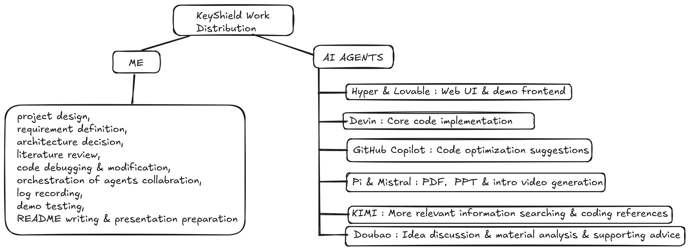

# **KeyShield**
### *Proactive Local Protection Against API Key Leakage for AI Developers*

---

# **Problem Statement**
### Why It Matters **Now**

**Critical Risks for AI Developers:**
- Post-hoc tools (TruffleHog, GitGuardian) detect secrets **after** they are exposed.
- Credential theft tools scrape and misuse keys **within minutes** of exposure.
- **No lightweight local solutions** exist without invasive keyboard logging.

**Why Now?**
- Explosive LLM adoption → More API keys in use.
- Solo devs & small teams lack dedicated security.
- Open-source culture increases accidental exposure risk.

---

# **Solution: KeyShield’s Two-Layer Defense**

### **Layer 1: Real-Time File Monitor**
- Runs in the background, watching file changes.
- **Instant desktop popup** when LLM API keys are detected.

### **Layer 2: Git Pre-Commit Hook**
- **Blocks commits** containing exposed secrets.
- Prevents accidental uploads to GitHub.

**Key Principles:**
✅ **Zero Persistence** – No database, no login, never stores secrets.
✅ **Privacy-First** – Only scans file content, **never monitors input**.
✅ **Lightweight** – Minimal dependencies, instant detection.

---

# **Working Prototype: Desktop Alerts**


---


---

# **Working Prototype: Web UI**


---

# **Market Size & Opportunity**

### **Total Addressable Market (TAM)**
- **$2.5B** (Global developer security tools, 2024).
- **15% CAGR** due to API growth and security awareness.

### **Serviceable Addressable Market (SAM)**
- **500K** individual AI developers & small teams globally.
- **200K** developers using 3+ LLM providers.
- **100K** open-source-first users.

---

# **Revenue Model**

| Tier | Features | Price |
|------|----------|-------|
| **Free** | Basic monitoring (5 providers), community support | Free |
| **Pro** | All 10+ providers, priority support, custom patterns, auto-masking | **$9/month** |
| **Enterprise** | Team dashboard, SSO, audit logs, Slack/Teams integration | **$49/month** |

**Additional Revenue:**
- Custom pattern consulting.
- White-label licensing.
- Training & onboarding.

---

# **Competitive Advantage**

| Feature | TruffleHog | GitGuardian | Gitleaks | **KeyShield** |
|---------|------------|-------------|----------|--------------|
| **Proactive Detection** | ❌ (Post-commit) | ❌ (Post-commit) | ❌ (Post-commit) | ✅ **Real-time** |
| **Local-Only** | ❌ (Server-based) | ❌ (Cloud) | ✅ | ✅ **Zero cloud** |
| **Desktop Alerts** | ❌ | ❌ | ❌ | ✅ **Instant popups** |
| **Git Hook Integration** | ❌ | ✅ | ✅ | ✅ **Auto-blocking** |
| **Privacy-First** | ✅ | ❌ | ✅ | ✅ **No keyboard logging** |

---

# **Team**

- **Built by**: Solo developer + AI agent team.
- **Work Distribution**:



---

# **Roadmap**

### **Phase 1: MVP (Current)**
✅ Open-source core with real-time monitoring and git hooks.
✅ Support for 10+ LLM providers.

### **Phase 2: Community Growth**
🔹 Expand pattern library (AWS, Azure, GCP).
🔹 Linux/Mac desktop notifications.
🔹 Contributor onboarding.

### **Phase 3: Monetization**
🔹 Launch **Pro Tier** ($9/month).
🔹 Mobile companion app.

### **Phase 4: Enterprise Expansion**
🔹 **Enterprise Tier** ($49/month).
🔹 CI/CD integration (GitHub Actions, GitLab CI).
🔹 Partnerships with LLM providers.

---

# **Impact & Growth Potential**

### **Security Impact**
- **Goal**: Reduce API key leakage incidents by **80%** for individual developers.
- Eliminate remediation time spent on leaked credentials.

### **Developer Productivity**
- No more panic over accidental commits.
- Seamless workflow with instant feedback.

### **Open Source & Education**
- Foster a **security-first culture** in AI development.
- Raise awareness about secret management best practices.

---

# **Key Takeaways**

✅ **Proactive protection** – Stops leaks **before** they happen.
✅ **Privacy-first** – No cloud, no logging, no keyboard monitoring.
✅ **Developer-friendly** – Lightweight, easy setup, instant feedback.

---

# **Thank You!**

### **Next Steps**
- **Try it**: [GitHub Repository](#) (Link to repo).
- **Join the community**: Contribute patterns, report issues.
- **Upgrade to Pro**: Unlock premium features.

### **Contact**
- **Project**: KeyShield
- **License**: MIT Open Source
- **Built for**: AI GENESIS Hackathon

---

# **Appendix: Quick Start**

```bash
# Clone and install
git clone <repository-url>
cd KeyShield
python -m venv .venv
source .venv/bin/activate  # Linux/Mac
.venv\Scripts\activate     # Windows
pip install -r requirements.txt

# Run real-time monitor
python -m app.monitor

# Install git hook
cp pre_commit_hook.py .git/hooks/pre-commit
chmod +x .git/hooks/pre-commit  # Linux/Mac
```

---

# **Appendix: Supported LLM Providers**

- OpenAI
- Anthropic
- Google
- Cohere
- Hugging Face
- Mistral
- Together AI
- Perplexity
- Replicate
- Tavily
