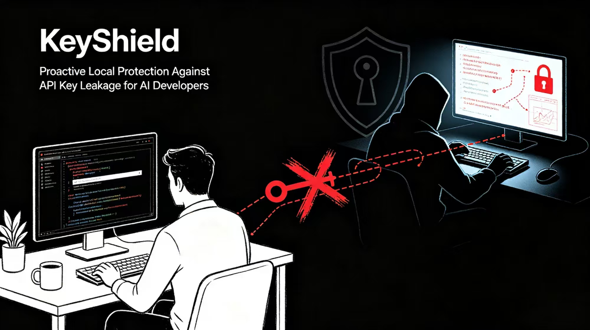

# KeyShield

**Proactive Local Protection Against API Key Leakage for AI Developers**

---

- Read [README.md](README.md) for project overview and market analysis
- Read [README_detailed.md](README_detailed.md) for technical documentation
- Read [TRY_ME.md](TRY_ME.md) to quick start
- Read [NEWS.md](NEWS.md) for ongoing insights

---

## Description

Lightweight local security tool that prevents API key leakage by monitoring file changes in real-time and blocking git commits containing exposed secrets.

## Technology & Category Tags

**Tags:** Security, Developer Tools, AI/ML, DevSecOps, Open Source

**Tech Stack:** Python, FastAPI, watchdog, tkinter, regex

## Problem

Individual AI developers face significant security risks with API key management:

- **Post-hoc scanning tools** only detect secrets after they've been committed and pushed online - by then, credentials may already be harvested
- **Credential theft tools** in the wild can rapidly scrape, validate, and misuse exposed keys from public repositories
- **No lightweight local solutions** exist that continuously monitor file changes without invasive keyboard logging

## Solution

KeyShield provides **proactive, local prevention** rather than retrospective detection:

- **Layer 1: Real-Time File Monitor** - Runs quietly in the background, dynamically watching file modifications. When LLM API keys are detected, it immediately triggers a native desktop warning popup.
- **Layer 2: Git Pre-Commit Hook** - Final barrier that blocks git commits containing exposed secrets, preventing accidental uploads to GitHub.

**Key principle**: KeyShield only scans file content and never records or monitors keyboard input.

## Key Features

- **Multi-LLM API Key Recognition** - Detects keys from OpenAI, Anthropic, Google, Cohere, Hugging Face, Mistral, Together AI, Perplexity, and Replicate
- **Real-Time Desktop Alerts** - Native Windows popup warnings with file path, provider type, and masked secret
- **Git Pre-Commit Blocking** - Automatically blocks commits containing exposed secrets
- **Zero Persistence** - No database, no login, never stores or logs your secrets
- **Lightweight & Fast** - Minimal dependencies, instant detection on file save

---

## Quick Start

**For a complete hands-on testing guide, see [TRY_ME.md](TRY_ME.md)**

### Installation

```bash
# Clone the repository
git clone <repository-url>
cd KeyShield

# Create a virtual environment (recommended)
python -m venv .venv

# Activate the virtual environment
# On Windows:
.venv\Scripts\activate
# On Linux/Mac:
source .venv/bin/activate

# Install dependencies
pip install -r requirements.txt
```

### Run Real-Time Monitor

```bash
python -m app.monitor
```

The monitor will watch all files in the current directory and subdirectories. When you save a file containing an API key, you'll see an immediate desktop popup warning.


### Install and Test the Git Pre-Commit Hook

The hook uses the Python interpreter available to Git; a virtual environment is not required. Make sure Python is installed and available on your `PATH`.

In PowerShell, from the repository root, install the hook:

```powershell
New-Item -ItemType Directory -Force .git\hooks | Out-Null
Copy-Item .\pre_commit_hook.py .git\hooks\pre-commit
```

To verify it, stage a temporary file containing a **fake** key. The commit should be blocked:

```powershell
Set-Content -NoNewline .keyshield-hook-test.txt 'OPENAI_API_KEY=sk-12345678901234567890'
git add -- .keyshield-hook-test.txt
git commit -m "test KeyShield pre-commit hook"
```

After confirming the commit was blocked, remove the temporary file and stage its removal:

```powershell
Remove-Item .keyshield-hook-test.txt
git add -u -- .keyshield-hook-test.txt
```

Do not use a real API key for this test.

Now every `git commit` will be automatically scanned for secrets before proceeding.

### Demo Application

**Platform:** Local deployment (FastAPI + uvicorn)

**Access:** Run `uvicorn app.main:app --host 0.0.0.0 --port 8000` and open `http://localhost:8000`

The web UI allows manual text masking and provides API endpoints for integration.

---

### Running Results

**Desktop Alert Popup:**


**Web UI with Sample Keys:**


### KeyShield's Unique Selling Proposition

1. **Proactive vs Reactive**: Detects secrets before they leave local environment
2. **Zero Infrastructure**: Runs entirely on local machine, no cloud services
3. **Immediate Feedback**: Desktop popups provide instant awareness
4. **Privacy-First**: No keyboard logging, zero persistence
5. **Developer-Friendly**: Simple setup, minimal dependencies

## Future Prospects

### Scalability
- **Platform Expansion**: Linux/Mac desktop notifications, mobile companion app
- **Provider Expansion**: Add support for cloud providers (AWS, Azure, GCP)
- **Enterprise Features**: Team collaboration, policy enforcement, audit trails
- **CI/CD Integration**: GitHub Actions, GitLab CI, Jenkins plugins

### Impact Potential
- **Security Impact**: Reduce API key leakage incidents by 80% for individual developers
- **Developer Productivity**: Eliminate remediation time spent on leaked credentials
- **Open Source Community**: Foster a security-first culture in AI development
- **Educational Value**: Raise awareness about secret management best practices

### Growth Strategy
- **Phase 1**: Open source MVP with core features (current)
- **Phase 2**: Community building, contributor onboarding, pattern library expansion
- **Phase 3**: Pro tier launch with premium features
- **Phase 4**: Enterprise features and partnerships with LLM providers

## Security & Privacy

- **Zero Persistence**: Secrets are never stored, logged, or cached
- **Client-Side Only**: All detection happens in memory on your machine
- **No Keyboard Logging**: Only scans file content, never monitors input
- **Masked Output**: API responses only return masked values

## Limitations

- Hackathon MVP prototype
- Currently optimized for Windows (tkinter popups)
- Only detects known API key patterns
- Manual intervention required to actually mask files in place

## Documentation

For detailed technical documentation, API reference, testing instructions, and project structure, see [README_detailed.md](README_detailed.md)


For a quick hands-on testing guide, see [TRY_ME.md](TRY_ME.md)

video isn't available yet.

For slide presentation,click https://github.com/memostudycode/KeyShield/blob/main/KeyShield_Slide_Deck.pdf

## License

MIT License

## Team

I finished it with my agents team.


## Acknowledgments

Built for AMD Developer Hackathon : ACT III Hackathon in 2026.

## Fun fact

I got blocked by my own KeyShield hook while committing the demo fake secrets for this project. It works exactly as designed!


