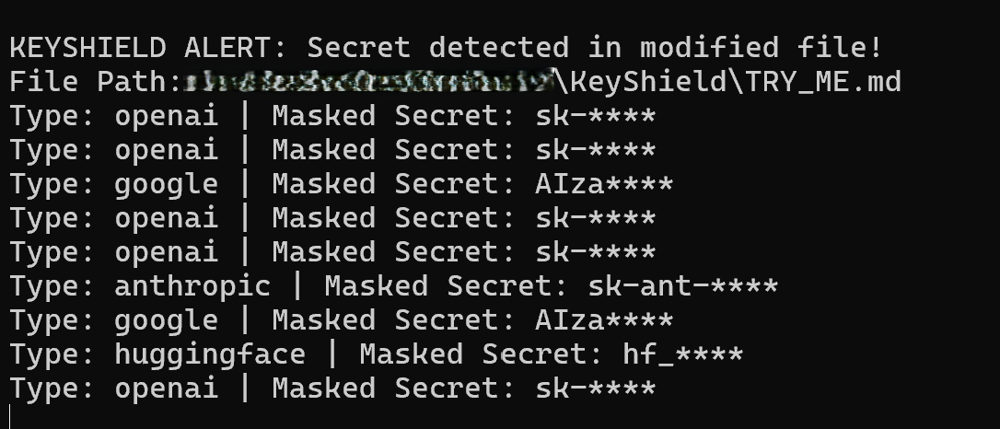
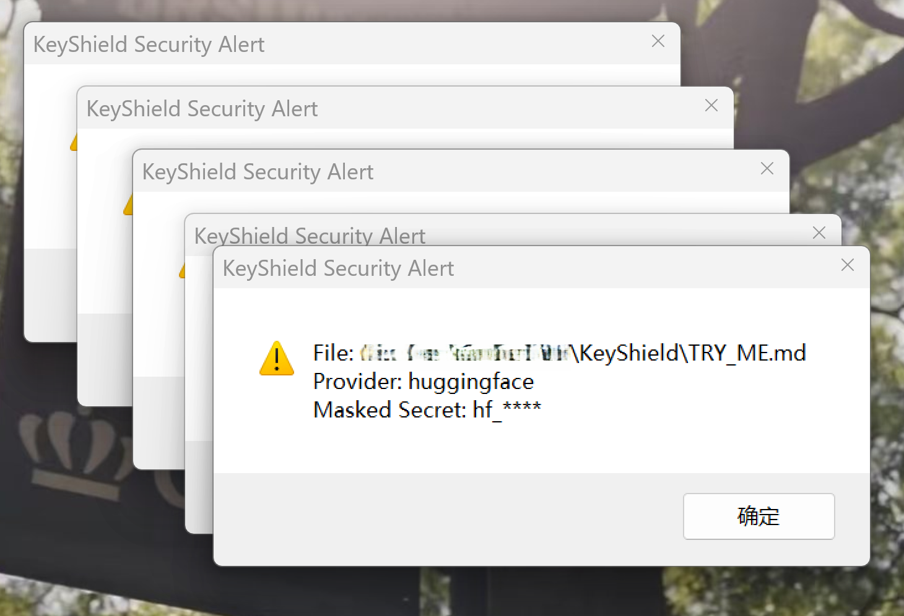
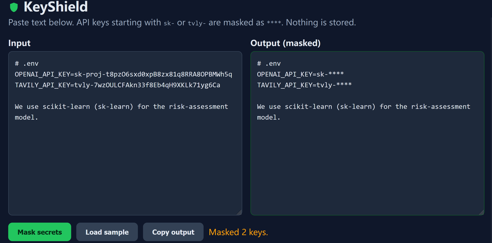

# KeyShield

KeyShield is a local secret/API key safeguard tool designed to detect exposed LLM API keys in source code, mask secrets, and prevent unintended secret leakage before users push or upload code to public platforms.

    


---

- Read [README.md](README.md) for project overview and market analysis
- Read [README_detailed.md](README_detailed.md) for technical documentation
- Read [TRY_ME.md](TRY_ME.md) to quick start
- Read [NEWS.md](NEWS.md) for ongoing insights

---


## Current Situation

For individual AI developers working with large language models, API keys are critical and sensitive credentials. At present, most tooling around secret credentials falls into two broad categories, alongside other risky utilities.

The first category consists of post-hoc scanning tools. They only inspect code repositories after files have been committed and pushed online. These tools work purely as remediation measures rather than preventive safeguards. They cannot intercept risks at the source, on the developer's local machine, before code upload happens. By the time the scan finds exposed keys, the credentials may already have been harvested.

The second category of tools is built to verify whether leaked API credentials remain functional. Beyond that, many high-star open-source utilities focus on credential theft tactics, such as keystroke monitoring to capture secrets as users type them in. Once secret keys are accidentally submitted to public repositories, malicious actors can leverage these popular tools to rapidly scrape, validate and misuse exposed keys, draining API quota or gaining access to private resources. These widely available scripts create substantial security threats for solo developers.

There are very few lightweight solutions that run locally and continuously monitor file changes while coding, without invasive keyboard logging.

KeyShield addresses this gap with proactive protection. After users install and activate KeyShield on their local computer, the service runs quietly in the background to dynamically monitor file modifications. When LLM API keys are detected inside edited files, a native desktop warning popup will trigger immediately. It alerts developers before they attempt to commit or push code, blocking accidental secret leakage at the source. Importantly, KeyShield only scans file content and never records or monitors keyboard input.

## Competitive Differentiation

Most existing secret scanning tools either perform post-commit repository audits, work as server-side API authentication middleware, or require users to manually trigger scans via CLI commands. Some other related programs are built to steal API keys, introducing extra risks. KeyShield differentiates itself by running as a lightweight persistent background monitor on the developer's local machine. It dynamically watches file changes in real time. When LLM API keys are detected in modified files, it immediately triggers a native desktop warning popup, alerting users before secrets are committed and pushed. It focuses on proactive local prevention rather than retrospective detection after leakage.

## Features

- **Multi-LLM API Key Recognition**: Detects API keys from multiple mainstream LLM service providers including OpenAI, Anthropic, Google, Cohere, Hugging Face, Mistral, Together AI, Perplexity, and Replicate
- **Real-Time File Monitoring**: Watches file modifications in real-time and alerts when secrets are detected with both terminal output and Windows desktop popup warnings
- **Git Pre-Commit Hook**: Blocks git commits that contain exposed secrets, preventing accidental uploads to GitHub
- **Zero Persistence**: No database, no login, and never stores or logs your secrets
- **Configurable Patterns**: Easy to add new provider key rules via pattern configuration

## Installation

```bash
# Create a virtual environment (recommended)
python -m venv .venv

# Activate the virtual environment
# On Windows:
.venv\Scripts\activate
# On Linux/Mac:
source .venv/bin/activate

# Install dependencies
pip install -r requirements.txt
```

## Quick Start

**For a complete hands-on testing guide, see [TRY_ME.md](TRY_ME.md)**

### Run Real-Time Monitor

```bash
python -m app.monitor
```

The monitor will watch all files in the current directory and subdirectories. When you save a file containing an API key, you'll see an immediate desktop popup warning.

### Install Git Pre-Commit Hook

```bash
cp pre_commit_hook.py .git/hooks/pre-commit
chmod +x .git/hooks/pre-commit  # Linux/Mac only
```

Now every `git commit` will be automatically scanned for secrets before proceeding.

### Manual Text Masking (Optional)

```bash
uvicorn app.main:app --host 0.0.0.0 --port 8000
```

Open `http://localhost:8000` in a browser to manually paste and mask text. The web UI provides an input box on the left and displays the masked output on the right.

## Running Results

**Desktop Alert Popup:**





**Web UI with Sample Keys:**



## Real-Time File Monitor

Run the background file monitor to watch for secret detection in real-time:

```bash
python -m app.monitor
```

The monitor will:
- Watch all files in the current directory and subdirectories
- Scan files when they are modified
- Display alerts in the terminal when secrets are detected
- Show Windows desktop popup warnings with file path, provider, and masked secret
- Continue running until you press Ctrl+C

## Git Pre-Commit Hook Setup

To block commits that contain exposed secrets, install the pre-commit hook:

```bash
# Copy the hook script to your git hooks directory
cp pre_commit_hook.py .git/hooks/pre-commit

# Make it executable (Linux/Mac)
chmod +x .git/hooks/pre-commit

# On Windows, Git will automatically make it executable
```

The pre-commit hook will:
- Automatically run before every `git commit`
- Scan all staged files for API secrets
- Block the commit if secrets are found
- Display terminal error details and Windows popup warnings
- Allow the commit only after secrets are removed or masked

**Note:** The hook script needs Python installed and accessible from the command line. It also requires the KeyShield dependencies to be installed in your Python environment.

## API Endpoints

### POST /api/mask

Masks API keys in the provided text.

**Request:**
```json
{
  "text": "your code with secrets here"
}
```

**Response:**
```json
{
  "masked_text": "key=sk-****",
  "count": 1,
  "findings": [
    {
      "type": "openai",
      "start": 4,
      "end": 31,
      "masked": "sk-****"
    }
  ]
}
```

The response never contains the raw secret. Inputs over 100,000 characters get a `422` error.

### GET /api/providers

Lists all supported API key providers and their patterns.

**Response:**
```json
[
  {
    "provider": "openai",
    "prefix": "sk-",
    "example": "sk-xxxxxxxxxxxxxxxxxx"
  },
  {
    "provider": "anthropic",
    "prefix": "sk-ant-",
    "example": "sk-ant-xxxxxxxxxxxxxxxxxx"
  }
]
```

### GET /api/monitor/git

Checks git staged files for secrets before push.

**Response (safe):**
```json
{
  "status": "safe",
  "message": "No secrets found in staged files"
}
```

**Response (secrets found):**
```json
{
  "operation": "git push",
  "secrets_found": [
    {
      "file_path": "config.py",
      "provider": "openai",
      "masked_value": "sk-****",
      "line_number": null
    }
  ],
  "affected_files": ["config.py"]
}
```

### GET /api/monitor/scan

Scans current directory for secrets.

**Response format:** Same as `/api/monitor/git`

### GET /health

Health check endpoint.

**Response:**
```json
{
  "status": "ok"
}
```

## Detection Rules

KeyShield uses configurable regex patterns to detect API keys:

- Each provider has a specific prefix pattern (e.g., `sk-` for OpenAI, `AIza` for Google)
- The prefix must be followed by **at least 10** characters from `[A-Za-z0-9_-]`
- The prefix must start a token (prevents false positives like `risk-assessment`)
- Short words like `sk-learn` are left alone
- New providers can be added by extending the `_PROVIDER_PATTERNS` list in `app/detector.py`

## Supported Providers

- **OpenAI**: `sk-` prefix
- **Anthropic**: `sk-ant-` prefix
- **Tavily**: `tvly-` prefix
- **Google AI/Gemini**: `AIza` or `GOOG` prefix
- **Cohere**: `cohere-` prefix
- **Hugging Face**: `hf_` prefix
- **Mistral AI**: `md-` prefix
- **Together AI**: `together_` prefix
- **Perplexity**: `pplx-` prefix
- **Replicate**: `r8_` prefix

## Monitoring System

KeyShield provides two layers of secret protection:

### Layer 1: Real-Time File Monitor
The background file monitor watches for file modifications:

**How it works:**
- Monitors all files in the current directory and subdirectories
- Scans files immediately when they are saved/modified
- Displays alerts in the terminal when secrets are detected
- Shows Windows desktop popup warnings with:
  - Warning title
  - Full file path
  - Secret provider type
  - Masked secret key

**To run:**
```bash
python -m app.monitor
```

### Layer 2: Git Pre-Commit Hook
The pre-commit hook provides final protection before pushing to remote repositories:

**How it works:**
- Automatically triggers before every `git commit`
- Scans all staged files for API secrets
- Blocks the commit if secrets are found
- Displays terminal error details
- Shows Windows desktop popup warnings
- Allows commit only after secrets are removed

**To install:**
```bash
cp pre_commit_hook.py .git/hooks/pre-commit
chmod +x .git/hooks/pre-commit  # Linux/Mac only
```

**Note:** The pre-commit hook is the final barrier that prevents accidental secret uploads to GitHub or other remote repositories.

## Testing

For a quick hands-on testing guide with step-by-step instructions, see [TRY_ME.md](TRY_ME.md)

### Unit Tests

```bash
python -m pytest -q
```

Test fixtures build fake keys at runtime, so the repo contains no key-shaped literals for a secret scanner to flag.

## Project Backbone Structure

```
app/
├── __init__.py          # Package marker
├── detector.py          # Regex detection + masking (pure function, no I/O)
├── main.py              # FastAPI: GET / (UI), GET /health, POST /api/mask, monitoring endpoints
├── monitor.py           # Real-time file operation monitoring with popup warnings
└── static/
    └── index.html       # Single-page UI, vanilla JS
tests/
├── test_api.py          # API endpoint tests
├── test_detector.py     # Detector unit tests
└── test_monitor.py      # Monitor unit tests
pre_commit_hook.py       # Git pre-commit hook script
```

## Technical Details

### Detector Module (`app/detector.py`)
- Pure functions with no I/O for easy testing
- Configurable provider patterns for extensibility
- Returns masked text and findings with original text offsets
- Never includes raw secrets in output

### Monitor Module (`app/monitor.py`)
- Real-time file watching using watchdog library
- Scans files on modification using FileSystemEventHandler
- Displays terminal alerts when secrets are detected
- Shows Windows desktop popup warnings using tkinter
- Gracefully handles non-git repositories
- Tkinter is built-in (no extra dependencies)

### Pre-Commit Hook (`pre_commit_hook.py`)
- Python script that installs as git pre-commit hook
- Scans all staged files before commit
- Blocks commit if secrets are found
- Displays terminal error details
- Shows Windows desktop popup warnings
- Returns exit code 1 to block commit when secrets detected

### API Module (`app/main.py`)
- FastAPI service with Pydantic validation
- Input size limits to prevent abuse
- Health check endpoint
- No logging of user input text

## Security Considerations

- **Zero Persistence**: Secrets are never stored, logged, or cached
- **Client-Side Processing**: All detection happens in memory
- **Masked Output**: API responses only return masked values
- **Input Validation**: Maximum input size of 100,000 characters
- **Two-Layer Protection**: Real-time monitoring + git pre-commit hook

## Limitations

- This is a hackathon MVP prototype
- Monitoring is based on file system events (not full syscall interception)
- Only detects known API key patterns
- False positives possible with code that looks like keys
- Manual intervention required to actually mask files in place
- Desktop popups require tkinter (built-in on most Python installations)
- Currently optimized for Windows (Linux/Mac popup support planned)

## Future Enhancements

- Add more provider patterns as needed
- Implement actual file in-place masking
- Support for custom user-defined patterns
- Configuration file for monitor settings
- Cross-platform desktop notifications (Linux/Mac support)
- Integration with CI/CD pipelines

- Add more provider patterns as needed
- Implement actual file in-place masking
- Support for custom user-defined patterns
- Configuration file for monitor settings
- Cross-platform desktop notifications (Linux/Mac support)
- Integration with CI/CD pipelines

## Attachments

For slide presentation,click https://github.com/memostudycode/KeyShield/blob/main/KeyShield_Slide_Deck.pdf

## License

MIT License

## Team

I finished it with my agents team.


## Acknowledgments

Built for ACT III Hackathon in 2026.

## Fun fact

I got blocked by my own KeyShield hook while committing the demo fake secrets for this project. It works exactly as designed!


